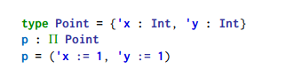

# Rosi Pygments

This repository adds a Pygments lexer for parsing Rosi code in LaTeX and other formats via Minted.

## Installation

Run `pip install -e .`, or `./install` (which is identical).

## Usage (LaTeX/Minted)
Installing the lexer using the instructions above should make it available globally.

### Minted environment

You can formally specify a rosi environment via:

```tex
\newminted[rosi]{rosi}{mathescape,escapeinside=!!, xleftmargin=\parindent, fontsize=\footnotesize}
```

(Vary the parameters as you see fit.) I also like to supply an in-line command, like so:

```tex
\newcommand\Code[2][]{\mintinline[#1]{#2}}
\newcommand\R[1]{\Code{rosi}{#1}}
```

If you are using Minted, you will necessarily need to run pdflatex/latexmk with a -shell-escape flag. I like to add:

```tex
% Local Variables:
% TeX-command-extra-options: "-shell-escape"
% End:
```

to the end of my files so that auctex adds the flag to its compilation commands.


### Unicode Support

Should you choose to use Rosi's unicode symbols, you will need to additionally configure your LaTeX project. I have added a file [unicode.sty](./unicode.sty) to this repository, which includes support for all all Rosi reserved symbols and many additional, commonly used characters.


### In LaTeX Bodies

If you have followed the instructions above, Minted will create an environment `rosi`, which can be used as so:

```tex
\begin{rosi}
type Point : * → *
type Point = {'x : Int, 'y : Int} 
p : Π Point
p = ('x := 1, 'y := 1) 
\end{rosi} 
```

Using the "colorful" Minted theme, this renders as:




## Making Changes

The base lexer is stolen from [Haskell's Pygments Lexer](https://github.com/pygments/pygments/blob/master/pygments/lexers/haskell.py). The lexer is modified to accommodate Rosi's reserved keywords, label literals, and other features of Rosi's syntax. I have chosen to retain Haskell's distinction between terms and types baed on case. That is, lowercase (unreserved) symbols are lexed and formatted separately from uppercase (unreserved) symbols.


## Future Work
In the future, I would like to add native Rosi support to:
- the [pygments](https://github.com/pygments/pygment) repository, thereby making it natively available; and
- Github's [linguist](https://github.com/github-linguist/linguist), which tracks language usage across github and would pretty-print Rosi code 

Some of these goals are quite far-off. On our end, the syntax of Rosi is still actively changing. On e.g. Github's end, *linguist* requires at least 200 unique repositories in Rosi before it may be accepted.

